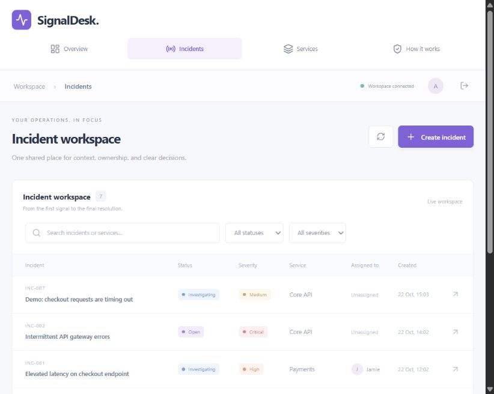
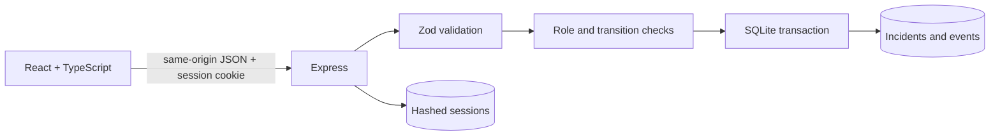

# SignalDesk

**Incident operations, without the noise.**

A full-stack incident management application built with **TypeScript, React, Express, and SQLite**. It focuses on the hard parts behind a dashboard: authorization, reliable state transitions, concurrency, and audit consistency.

> Portfolio project built with AI assistance. The accompanying learning guide explains the implementation and tradeoffs. Demo data is fictional; there are no claims of production customers or live monitoring integrations.



## Run locally

Requires **Node.js 22.13+** and npm. SQLite uses Node's built-in `node:sqlite` module, which may print an experimental warning in Node 22.

```sh
npm install
```

Copy `.env.example` to `.env` (Windows: `Copy-Item .env.example .env`). Demo seeding is explicitly enabled in that example.

```sh
npm run dev
```

Open **http://127.0.0.1:5180**. The API runs on **127.0.0.1:3010**. Vite proxies /api to the API; browser requests remain same-origin.

| Demo role | Email | Password |
| --- | --- | --- |
| Administrator | admin@signaldesk.demo | DemoPass123! |
| Responder | responder@signaldesk.demo | DemoPass123! |
| Viewer | viewer@signaldesk.demo | DemoPass123! |

The shared demo credentials are intentionally public. Never use this seed with real/private incident data.

## What works

- Session authentication using random opaque tokens, stored hashed in SQLite; HttpOnly, SameSite=Strict cookies, 8-hour expiry, session rotation and logout revocation.
- Role checks on every write endpoint. Admins register services; responders manage incidents; viewers cannot mutate.
- Explicit incident lifecycle and safe reopening.
- Optimistic concurrency with a required version; stale updates return 409.
- Transactional incident changes and server-attributed activity events.
- Comments, assignee changes, searchable/filterable paginated incident list.
- Derived service health, active/critical counts, and MTTR.
- Responsive dashboard, keyboard-accessible dialogs, loading/error/empty states.
- Integration tests that exercise the HTTP API and a real in-memory SQLite database.

## Validate

```sh
npm test
npm run build
```

Tests cover authentication and session rotation, role bypass attempts, invalid state transitions, stale writes, audit integrity, validation, SQL injection-like search input, metrics, cross-site writes and login throttling. Tests do not mock the database.

## Production build

```sh
npm run build
npm start
```

Open **http://127.0.0.1:3010**. Express serves the compiled UI and API from the same origin.

For a public deployment, run on a Node host with a **persistent volume**, TLS termination, `COOKIE_SECURE=true`, and an appropriate `HOST`. Do not deploy the SQLite file on an ephemeral serverless filesystem. Secrets belong in host environment variables. The shipped CSP allows only same-origin assets and connections.

This version deliberately has no signup, password recovery, OAuth, email alerts, uptime probes, real-time socket feeds, multi-tenancy, or infrastructure automation. Demo accounts are the supported onboarding flow. Do not describe these features as implemented.

## Architecture



```text
src/main.tsx           UI, API client, dialogs and state
src/styles.css        Responsive application styles
server/app.ts         HTTP boundary, validation, permissions and transactions
server/db.ts          Schema, password hashing, transactions and demo seed
server/index.ts       Configuration, static hosting and shutdown
tests/api.test.ts     HTTP integration tests
docs/ARCHITECTURE.md  Data model, decisions and deployment boundaries
docs/UCENJE.md        Explanation and interview walkthrough in Bosnian
```

## API

| Method | Endpoint | Permission |
| --- | --- | --- |
| POST | /api/auth/login | Public, rate-limited |
| GET | /api/auth/me | Signed in |
| POST | /api/auth/logout | Signed in |
| GET | /api/incidents | Signed in; q, status, severity, page |
| POST | /api/incidents | Admin / responder |
| GET | /api/incidents/:id | Signed in |
| PATCH | /api/incidents/:id | Admin / responder; version required |
| POST | /api/incidents/:id/comments | Admin / responder |
| GET | /api/services | Signed in |
| POST | /api/services | Admin |
| GET | /api/overview | Signed in |
| GET | /api/users | Signed in |
| GET | /api/health | Public |

## Why these choices?

SQLite keeps the demo portable while supporting real transactions and constraints. WAL improves read/write coexistence; a single writer is an intentional limit. Express makes the request pipeline visible. Opaque sessions support revocation without JWT refresh-token machinery. Version checks demonstrate optimistic locking without needing an external lock service.

See [architecture decisions](docs/ARCHITECTURE.md) and [the learning guide](docs/UCENJE.md) for limitations, examples, and an interview demo.


## Publish to GitHub

This folder is initialized as a local Git repository. Create an empty repository named signaldesk on your GitHub account, then:

```sh
git add .
git commit -m "Build SignalDesk incident operations application"
git remote add origin https://github.com/YOUR_USERNAME/signaldesk.git
git push -u origin main
```

Replace YOUR_USERNAME with your account name. Set your own Git author identity if Git requests it. The .gitignore excludes local database files, .env, dependencies and build output. GitHub Actions validates tests and build after the first push.
